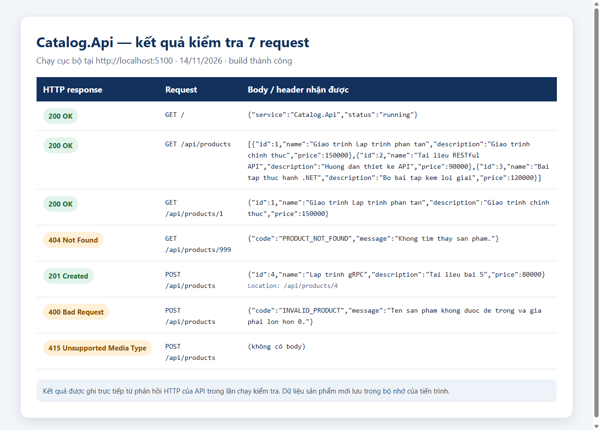

# Bài 2 — Catalog API

**Sinh viên:** Sùng A Dà — dtc245200607<br>
**Pull Request:** `Bai2 - dtc245200607 - SUNG A DA`

## Cấu trúc bài nộp

```text
Bai2/
└── Sùng A Dà - dtc245200607/
    ├── .gitignore
    ├── README.md
    ├── requests.http
    └── Bai2/
        ├── CatalogApi.slnx
        ├── Catalog.Api/
        └── Catalog.Client/
```

Mã nguồn nằm trong thư mục `Bai2`. `.gitignore` loại `bin/` và `obj/` khỏi Git.

## Yêu cầu

- .NET SDK tương thích với `net11.0`.
- VS Code cùng REST Client extension nếu muốn gửi request trực tiếp trong `requests.http`.

## Build và chạy

Mở terminal tại thư mục `Bai2/Sùng A Dà - dtc245200607/Bai2`:

```powershell
dotnet build CatalogApi.slnx
```

Chạy API ở Terminal 1:

```powershell
dotnet run --project Catalog.Api --urls http://localhost:5100
```

Gửi request bằng REST Client ở Terminal 2: mở `requests.http` ở thư mục cha và chọn **Send Request**. Có thể gọi nhanh bằng PowerShell:

```powershell
curl.exe -i http://localhost:5100/
curl.exe -i http://localhost:5100/api/products
curl.exe -i http://localhost:5100/api/products/1
curl.exe -i http://localhost:5100/api/products/999
```

Chạy console client ở Terminal 2 (thay vì lệnh gọi nhanh):

```powershell
dotnet run --project Catalog.Client -- http://localhost:5100
```

## Bảng phá thử và kết quả chạy

| # | Request | Kết quả thực tế |
|---|---|---|
| 1 | `GET /` | `200 OK`, trạng thái dịch vụ là `running` |
| 2 | `GET /api/products` | `200 OK`, danh sách có 3 sản phẩm mẫu ban đầu |
| 3 | `GET /api/products/1` | `200 OK`, trả về sản phẩm có ID 1 |
| 4 | `GET /api/products/999` | `404 Not Found`, mã `PRODUCT_NOT_FOUND` |
| 5 | `POST /api/products` với tên và giá hợp lệ | `201 Created`, trả sản phẩm mới và header `Location` |
| 6 | `POST /api/products` với tên rỗng, giá âm | `400 Bad Request`, mã `INVALID_PRODUCT` |
| 7 | `POST /api/products` không có `Content-Type` | `415 Unsupported Media Type` |

Đã chạy `dotnet build CatalogApi.slnx` và gửi lần lượt cả 7 request tới API cục bộ ngày 14/11/2026. Build thành công, 0 cảnh báo, 0 lỗi; các mã phản hồi nhận được là `200, 200, 200, 404, 201, 400, 415`. Request tạo hợp lệ trả `Location: /api/products/4`; hai trường hợp lỗi nghiệp vụ trả `PRODUCT_NOT_FOUND` và `INVALID_PRODUCT` đúng như bảng.

Ảnh dưới đây được tạo từ phản hồi thật của lần chạy trên:



Ví dụ body lỗi nhận được:

```json
{
  "code": "INVALID_PRODUCT",
  "message": "Ten san pham khong duoc de trong va gia phai lon hon 0."
}
```

## Trả lời câu hỏi

1. **Vì sao URI dùng danh từ, còn hành động do phương thức HTTP đảm nhận?** URI xác định tài nguyên, chẳng hạn `/api/products` là tập sản phẩm và `/api/products/1` là một sản phẩm. Phương thức HTTP cho biết thao tác: `GET` đọc, `POST` tạo. Cách này giữ đường dẫn nhất quán và để cùng một tài nguyên hỗ trợ nhiều thao tác.
2. **“Stateless” thể hiện ở đâu trong code đã viết?** Mỗi request gửi đến endpoint tự mang thông tin cần thiết qua URI, phương thức, header và body; API không dựa vào phiên hội thoại hay trạng thái client để hiểu request. Danh sách sản phẩm vẫn là dữ liệu phía server trong bộ nhớ, nhưng không phải trạng thái phiên của client; khi API khởi động lại, dữ liệu tạo thêm mất.
3. **Vì sao client và server mỗi bên khai báo DTO riêng mà vẫn khớp nhau?** Hai chương trình độc lập trao đổi JSON theo hợp đồng HTTP. DTO ở hai bên khớp khi tên trường, kiểu dữ liệu và cách tuần tự hóa JSON thống nhất; chúng không cần dùng chung một assembly hay mã nguồn.

## Ghi chú

Dữ liệu sản phẩm được giữ trong bộ nhớ của tiến trình API. Khi dừng API, sản phẩm mới tạo sẽ mất và danh sách trở về ba sản phẩm mẫu.
